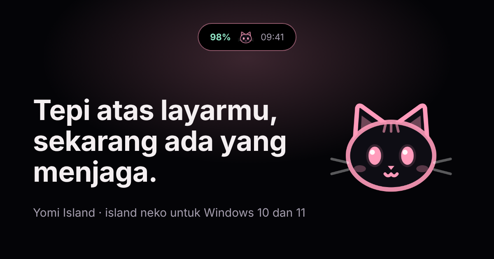
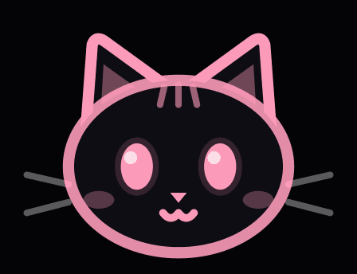

  

<h1 align="center">Yomi Island</h1>

  

  Island kecil bermaskot neko di tepi atas layar Windows. 
  Menampilkan baterai dan jam, lalu mengingatkan task, timer baca, jadwal anime, dan musikmu.

  <a href="https://crfebrian.github.io/yomi-island-site/"><b>Buka situs</b></a> &nbsp;|&nbsp;
  <a href="https://crfebrian.github.io/yomi-island-site/#unduh"><b>Unduh untuk Windows</b></a>

---

## Apa itu?

**Yomi Island** (yomi = membaca) adalah yomi kecil di tengah atas layar. Neko di dalamnya berubah ekspresi sesuai kegiatanmu: semangat saat ada yang perlu dikerjakan, kaget kalau sudah terlambat, tidur ketika semuanya beres. Klik pill untuk membuka panel.

Gratis untuk pemakaian pribadi, tanpa akun dan tanpa telemetri. Untuk Windows 10 dan 11.

## Yang ada di situsnya

- **Coba langsung** di browser: tekan skenario, lihat island bereaksi.
- **Cerita satu hari** bersama Yomi Island: task, baca, anime dan manga, musik, santai, dan mode otomatis.
- **Cara memasang** dan jawaban pertanyaan yang sering muncul.
- **[Kebijakan privasi](https://crfebrian.github.io/yomi-island-site/privasi.html)**.

---

Untuk pengelola situs

 

Situs statis (HTML, CSS, JS biasa, tanpa build), dipublikasikan lewat GitHub Pages dari branch `main`.

- Tombol Unduh mengarah ke `downloads/Yomi-Island-setup.exe`.
- Saat ada versi baru: timpa berkas itu dengan installer baru (namanya tetap sama), lalu ubah angka versi di `index.html` (hero dan bagian Unduh).
- Coba di komputer: `python -m http.server 8000`, lalu buka http://localhost:8000

  © 2026 CrFebrian

